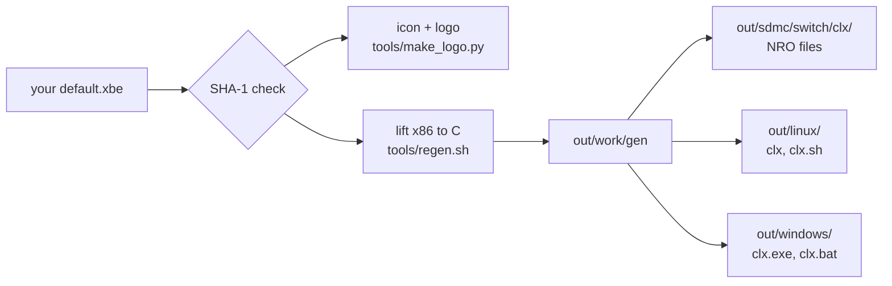

# Building

This page has the details behind the short steps in the [README](../README.md).

You build from your **own** `default.xbe`. The build lifts the game's x86 code to C on your
machine. The result contains code made from the game (and no game data). Ready-made builds are
in [Releases](https://github.com/rashevskyv/conker-lr-recomp/releases) if you do not want to build.

## 1. The disc

You need the unpacked disc of **Conker: Live & Reloaded** for the original Xbox. It must be the
**retail NTSC (North America)** version. Its `default.xbe` has this SHA-1:

```
2232a1b3874d67b4bb4cf53a940420d2dab59535
```

The build script checks it and stops on any other file. Other versions are not tested.

Unpack the disc image to a folder, for example with
[extract-xiso](https://github.com/XboxDev/extract-xiso) or
[xdvdfs](https://github.com/antangelo/xdvdfs):

```bash
extract-xiso -x Conker.iso -d conker-disc
sha1sum conker-disc/default.xbe
```

The folder has about 881 files (4.5 GB): `default.xbe`, `dvddata/`, `media/` and more.

## 2. What the build script does



`build_from_xbe.sh` does these steps:

1. Checks the SHA-1 of the XBE and the tools.
2. Makes the Switch icon and the loading logo from the XBE's own title image.
3. Lifts the XBE to C (`tools/regen.sh`). This takes 5 to 15 minutes and about 15 GB of RAM.
4. Builds what `VARIANTS` asks for.

A second run re-uses the lifted code and the build folders (in `out/work/`), so it is much faster.

| Variable | Default | Meaning |
|---|---|---|
| `VARIANTS` | `vulkan gl` | A list: `vulkan`, `gl` (Switch), `linux`, `windows` |
| `REGEN` | `0` | `1`: lift again |
| `JOBS` | by free memory | Compile jobs. Each needs about 1.5 GB of RAM. |
| `OUT` | `<repo>/out` | Output folder |
| `WORK` | `$OUT/work` | Lifted code and build folders |
| `DEVKITPRO` | `/opt/devkitpro` | devkitPro folder (Switch) |
| `NVK_SDK`, `GLSLANG_DIR` | in `$WORK` | Mesa NVK and glslang for the Switch. Built once if missing. |

## 3. Nintendo Switch

You build on Linux. On Windows use WSL2 (Ubuntu 24.04) or Docker. Put the repository
**inside** the Linux file system (in WSL2: `~/`, not `/mnt/c/`). The Windows drives are very
slow there.

You get two apps:

| File | Renderer |
|---|---|
| `clx-vulkan.nro` | Vulkan (Mesa NVK). Recommended. |
| `clx.nro` | OpenGL. A fallback. It also runs in the Eden emulator. |

### With Docker (recommended)

The image has devkitPro, the Python tools, NVK and glslang at fixed versions. Its first build
takes about 1 hour (most of it is NVK).

```bash
docker build -t clx-build .
docker run --rm --user "$(id -u):$(id -g)" -e HOME=/tmp \
  -v "$PWD:/src" -v "$HOME/conker-disc:/xbe:ro" \
  clx-build ./build_from_xbe.sh /xbe/default.xbe
```

### Without Docker

1. Install [devkitPro](https://devkitpro.org/wiki/Getting_Started) and these packages:

   ```bash
   sudo dkp-pacman -S switch-dev switch-sdl2 switch-mesa switch-libdrm_nouveau switch-glad \
     switch-libzstd switch-libexpat switch-zlib
   ```

2. Install the host tools (Ubuntu 24.04):

   ```bash
   sudo apt install python3-pip cmake ninja-build git rsync
   pip3 install --break-system-packages capstone==5.0.7 Pillow
   ```

3. For the Vulkan app, install the NVK prerequisites listed at the top of
   [tools/build_nvk.sh](../tools/build_nvk.sh). The script builds NVK once (about 1 hour).
   It writes small helper files to `/usr/local/libexec` and to devkitPro's `portlibs/switch`.
   Run it as root, or use Docker. For the OpenGL app only, skip this step and set `VARIANTS=gl`.

4. Build:

   ```bash
   ./build_from_xbe.sh ~/conker-disc/default.xbe
   ```

Each app takes about 40 minutes the first time.

### Install on the Switch

The output is in `out/sdmc/switch/clx/`:

| File | What it is |
|---|---|
| `clx-vulkan.nro`, `clx.nro` | the apps |
| `clx_options.txt` | picture, frame rate, camera ([settings](settings-and-controls.md)) |
| `clx_env.txt` | advanced switches, with a comment for each (clocks, threads, logging) |

1. Copy the contents of `out/sdmc/` to the root of the microSD card.
2. Copy your unpacked disc folder to `sdmc:/switch/clx/game/`.
   `sdmc:/switch/clx/game/default.xbe` must exist. You need about 5 GB.
3. Start the app with **title takeover**: hold **R** while you open any game, then pick the app
   in hbmenu. Album (applet) mode does not have enough memory.
4. The first start compiles shaders and saves them (`progcache.bin`, `vk*.bin`). The first
   minutes can stutter. Later starts are smooth. Let the first start finish.

The version in hbmenu is `0.<commits>.<hash>` (`-vk` for Vulkan), from the git history. A ZIP
download without git shows `0.0.nogit`.

## 4. Linux

You need a GPU with OpenGL 3.3.

```bash
sudo apt install build-essential cmake ninja-build pkg-config git python3-pip \
  libsdl2-dev libssl-dev libepoxy-dev
pip3 install --break-system-packages capstone==5.0.7 Pillow
VARIANTS=linux ./build_from_xbe.sh ~/conker-disc/default.xbe
```

Run it:

```bash
out/linux/clx.sh ~/conker-disc
```

`out/linux/` is a complete folder: `clx`, `clx.sh` and `clx_options.txt`. At run time it needs
the shared libraries SDL2, OpenSSL and libepoxy.

| What | Where |
|---|---|
| Console save partitions | `~/.local/share/xboxrecomp` |
| Shader cache | `~/.cache/clx` |
| `UDATA`, `CACHE`, `TDATA` | in the disc folder (use a folder you may write to) |
| Messages | the terminal |

To try the game without a window, use `SDL_VIDEODRIVER=offscreen` and `SDL_AUDIODRIVER=dummy`.
`RECOMP_GL_DUMP=<folder>/f,150` writes a picture every 150 frames.

## 5. Windows

The Windows build uses MSYS2 (clang, MinGW) and the OpenGL renderer. You need a GPU with
OpenGL 3.3.

1. Install [MSYS2](https://www.msys2.org) (for example `winget install MSYS2.MSYS2`).
2. In PowerShell, in a clone of this repository:

   ```powershell
   .\build_from_xbe.ps1 C:\conker-disc\default.xbe -Install
   ```

   `-Install` installs the MSYS2 packages: clang, SDL2, cmake, ninja, pkgconf, Python with
   capstone and Pillow, and git. The first build lifts the XBE (about 5 to 15 minutes) and
   compiles (about 5 minutes).

   You can also run `VARIANTS=windows ./build_from_xbe.sh <xbe>` in an MSYS2 **UCRT64** shell.
3. Run it:

   ```powershell
   out\windows\clx.bat C:\conker-disc
   ```

`out\windows\` is a complete folder: `clx.exe`, the DLLs, `clx.bat`, `clx.ps1` and
`clx_options.txt`. You can move it.

| What | Where |
|---|---|
| Console save partitions (sparse files) | `%LOCALAPPDATA%\xboxrecomp` |
| Shader cache | `%LOCALAPPDATA%\clx` |
| `UDATA`, `CACHE`, `TDATA` | in the disc folder (use a folder you may write to) |
| Messages | `clx_log.txt` and `clx_err.txt` next to `clx.bat` |

`clx.exe` is a GUI program, so it has no console window.
