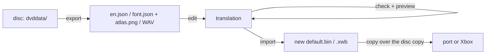

# Translating Conker: Live & Reloaded (Xbox)

This kit unpacks the game's text, fonts and voices to plain files (JSON, PNG,
WAV) and packs them back. It ships no game data: you need your own disc.

Tools are in `tools/l10n/`:

| Tool | What it does |
|---|---|
| `conker_text.py` | text banks <-> one JSON per language, with bubble layout, speaker slot, voice file |
| `conker_font.py` | font <-> `atlas.png` + `font.json` (glyph boxes and advances) |
| `conker_audio.py` | wave banks <-> WAV files + `audio.json` index |
| `bubble_preview.html` | shows one line as the game's speech bubble, with the real font |



## 1. What you need

- Python 3.9 or newer. Pillow for fonts (`pip install pillow`). Nothing else.
- The unpacked disc (for example with `extract-xiso`). Paths below use
  `GAME=<your unpacked disc>`. Work on a copy. Never overwrite the only copy.

Where things are on the disc:

| Data | Path | Format |
|---|---|---|
| Text, 7 languages x 69 banks | `dvddata/aid/text/<Language>/<Bank>/default.bin` | CAFF bank with an LSBL string table |
| Fonts | `dvddata/aid/font/{ConkerFont,FrontendTitle,ConkerFontJapanese,FrontendTitleJapanese}/default.bin` | CAFF, L8 atlas |
| Voices, music, sound effects | `dvddata/Audio/*.xwb` (76 banks) | XACT wave bank, version 3 |
| Sound banks (cue names) | `dvddata/Audio/conker_sb.bin` | 58 XACT sound banks in one file |

## 2. Text

### Export

```bash
python tools/l10n/conker_text.py export GAME/dvddata/aid/text English en.json
```

This writes every string of the English slot (3664 strings) to `en.json`.
The font next to the text folder is found by itself; give `--font FILE` if it
is somewhere else. The `Audio` folder next to `aid` is found too: then each
cutscene line names its voice WAV.

Bubble limits: the default is the original game (20 characters, 4 lines).
For the Switch/PC port with the wide subtitle box, add `--bubble wide`
(40 characters, 6 lines, height 240; port options `bubble_wrap`,
`bubble_lines`, `bubble_height`). Text that fits 20 x 4 fits both.

### One entry of the JSON

```json
{
 "bank": "TrainingLevel", "id": 7, "key": "cutscene_W1_TRAINING_12_0",
 "kind": "cutscene", "scene": "W1_TRAINING", "cutscene": 12, "line": 0,
 "source": "Ah, who's this guy?{PARAGRAPH}If you think ...",
 "text":   "Ah, who's this guy?{PARAGRAPH}If you think ...",
 "speaker": null, "display_time": null,
 "sounds": [{"cue": 266, "file": "gargoyle1.wav", "xwb": "cut_hungover",
             "wave": 5, "seconds": 41.318, "wav": "cut_hungover/0005_gargoyle1.wav"}],
 "layout": {"wrap": 20, "max_lines": 4, "fits": false,
   "paragraphs": [{"lines": ["Ah, who's this guy?"], "units": 19,
                   "text_w": 184.7, "text_h": 25.0, "bubble_w": 234.7, "bubble_h": 65.0,
                   "scrolls": false}, "..."],
   "warnings": ["paragraph 5: 13 lines > 4, the text scrolls"]}
}
```

| Field | Meaning | You edit it? |
|---|---|---|
| `bank`, `id`, `key` | where the string lives; `key` is the name the game looks up | no |
| `kind` | `cutscene` (speech bubble) or `ui` (menus, tips, HUD) | no |
| `scene`, `cutscene`, `line` | parts of a cutscene key `cutscene_<scene>_<cutscene>_<line>` | no |
| `source` | the original text | no |
| `text` | your translation (starts as a copy of `source`) | **yes** |
| `speaker` | who speaks; the game files do not say it, so it is empty | yes, for your notes |
| `display_time` | seconds the line stays; unknown (see limits), empty | optional |
| `sounds` | the cutscene's sound list; `wav` is the file `conker_audio.py export` writes | no |
| `layout` | the bubble the game will draw for `text` | no (`check` recomputes it) |
| `missing_glyphs` | characters of `text` that the font does not have | no |

One cutscene often has one voice file for all its lines (one long track).
`seconds` is that track's length.

### Edit, check, preview

1. Edit only `text`. Keep every `{TAG}` (see the tag list below).
2. Recompute the layout and list the problems of edited lines:

   ```bash
   python tools/l10n/conker_text.py check en.json
   ```

   It prints, for each edited line that does not fit: scrolling paragraphs,
   words longer than the wrap width, bubbles wider than 600 px, unknown tags,
   missing glyphs. Many original English lines scroll too (159 lines): a
   scroll is allowed, it is a warning.
3. Look at a line as a bubble: open `tools/l10n/bubble_preview.html` in a
   browser and load `font.json`, `atlas.png` (from `conker_font.py export`)
   and your JSON. Type in the box; the bubble updates at once. "Download
   edited JSON" saves your changes. From a local web server you can also open
   `bubble_preview.html?font=font.json&atlas=atlas.png&text=en.json`.

### Import

```bash
python tools/l10n/conker_text.py import GAME/dvddata/aid/text en.json out/
```

This writes only the changed banks, to `out/English/<Bank>/default.bin`.
`--lang French` writes into another language slot (the source banks are then
read from that slot; the keys must match). Copy the new files over the disc
copy. Any length works: the tool moves every table and fixes every size and
the header checksum (details in `docs/conker-text-limits-picoripi.md`).

### Tags

A tag counts as one character for the wrap. Write them exactly (upper case).

| Tag | Effect |
|---|---|
| `{PARAGRAPH}` | next bubble |
| `{PMARKER}` | a break point: the line may break here (like a space, but it draws nothing) |
| `{THOUGHT}`, `{ELECTRONIC}` | bubble style |
| `{NORMAL}` `{RED}` `{GREEN}` `{BLUE}` `{YELLOW}` | text colour |
| `{JIGGLE}`, `{THROB}` | text effect |
| `{A}` `{B}` `{X}` `{Y}` `{Z}` `{L}` `{R}` `{JOYSTICK}` `{ARROW_LEFT}` `{ARROW_RIGHT}` `{ARROW_UP}` `{ARROW_DOWN}` | button icons |
| `{SKULL}` `{SWIRL}` `{STAR}` `{LIGHTNING}` | icons (used for censored swearing) |
| `{TXT_ST}` `{TXT_ND}` `{TXT_RD}` `{TXT_TH}` `{TXT_MORE}` `{TXT_CURSOR}` `{TXT_JOYSTICK}` `{TXT_IGNORE}` | small UI glyphs |

An unknown tag (a typo) becomes a wrong code in the game.

### Limits (from the game code)

| Rule | Value | Where |
|---|---|---|
| wrap width | 20 code units (40 with the wide box) | 0x000DFD90 |
| break | at the last space or `{PMARKER}` once a line passes the width | 0x000DFD90 |
| long word | is not split; the bubble gets wider | 0x000DFD90 |
| lines per bubble | 4 (6 wide); more lines: fixed height 160 (240), the text scrolls | 0x000E0B9C |
| bubble size | 1-3 lines: text width + 50, text height + 40; at the limit: + 50, + 60; over: max(text width + 60, 150), fixed height | 0x000E0B5E |
| text size | font scale 0.81 x bubble scale 0.9; letters a-z as small capitals (0.81) | 0x000E2325 |
| one string on screen | under 2047 characters | text node, 0x1000 bytes |
| one cutscene line, all paragraphs | under 511 characters (a static buffer on one path) | 0x0076F108 |
| Japanese | no minimum width, display time x 2.5 | 0x0042C91F |

Long speech: when a paragraph's display time `t` (seconds) gives
`0.6 x t >= 5`, the game widens the wrap to `length / (0.6 x t)` (never
below 20). The time comes from the cutscene script, which the kit does not
read, so `display_time` is empty and the layout assumes the plain width. If
you know a time, put it in `display_time` and run `check`.

**Small capitals:** the game draws a-z as A-Z at 0.81 size. Only ASCII a-z
get this. Lowercase Cyrillic letters are drawn with their own glyphs at full
size. So either draw lowercase Cyrillic glyphs as small capitals in the
atlas, or map both cases to the same glyph (see Fonts).

## 3. Fonts

```bash
python tools/l10n/conker_font.py export GAME/dvddata/aid/font/ConkerFont/default.bin font_ConkerFont
# edit font_ConkerFont/atlas.png and font_ConkerFont/font.json
python tools/l10n/conker_font.py import GAME/dvddata/aid/font/ConkerFont/default.bin font_ConkerFont out/ConkerFont/default.bin
```

| Font | Glyphs | Atlas | Used for |
|---|---|---|---|
| ConkerFont | 199 | 256 x 240 | speech bubbles, most menus |
| FrontendTitle | 123 | 512 x 203 | front-end titles |
| ConkerFontJapanese | 1187 | 1024 x 772 | Japanese |
| FrontendTitleJapanese | 370 | 1024 x 335 | Japanese titles |

`atlas.png` is grey: white is ink (the game uses it as alpha). `font.json`:

```json
{"line_height": 37, "space_width": 9, "fallback": 9633, "atlas": [256, 240],
 "glyphs": [{"index": 23, "chars": [65], "text": "A", "x": 236, "y": 81, "w": 19, "h": 22,
             "xoff": 0, "yoff": 8, "advance": 18, "kern": -1, "ascent": 22, "uv": [...], "uv_rect": [...]}]}
```

- `x, y, w, h`: the glyph's box in the atlas. `xoff`, `yoff`: where the box
  goes from the pen and the line top. `advance`: how far the pen moves.
  `ascent`: baseline minus `yoff`. `kern` is -1 in every font.
- `text` (or `chars`, code points): the characters drawn with this glyph.
  One glyph can serve several characters (`"text": "Жж"`).
- `fallback`: the code drawn for a missing character (9633 = □).
- `uv`, `uv_rect`: leave them. When you move a box, `uv` is computed again.

**Adding Cyrillic:** the glyph count and the atlas size must stay. ConkerFont
has about 100 accented Latin glyphs (À...ÿ) that a Ukrainian or Russian
translation does not need. Re-use them: change `text` to the new letter,
draw it in the same box (or a new box in free atlas space), set `advance`.
The char hash table is rebuilt for you (the game's lookup 0x003D4A50 allows
more probes; the tool sets the count).

## 4. Audio

```bash
python tools/l10n/conker_audio.py index GAME/dvddata/Audio audio.json --text GAME/dvddata/aid/text/English
python tools/l10n/conker_audio.py export GAME/dvddata/Audio wav cut_hungover sfx_speech_eng
python tools/l10n/conker_audio.py import GAME/dvddata/Audio/cut_hungover.xwb my_wavs/ out/cut_hungover.xwb
```

- `index`: every bank and wave: codec, channels, rate, length, loop, and for
  cutscene speech the cue name and the text keys that use it (400 waves).
- `export`: WAVs `NNNN_<cue>.wav` (16-bit PCM). The banks are 3.7 GB in total:
  export only the banks you need.
- `import`: every `NNNN*.wav` in the folder replaces wave `NNNN`. The WAV must
  be 16-bit PCM. Any sample rate (the bank stores it per wave); keep the
  channel count. A looping wave loops over the whole new sound.

Banks: `cut_*` = cutscene speech (one track per cutscene), `sfx_speech_*` =
in-game speech, `m_*` = music, `am_*` = ambience, `sfx_*`/`hd_sfx*` =
effects, `multi_*`/`sfx_spe_multi*`/`sfx_speech_mult` = multiplayer.
Codecs: PCM 16-bit everywhere, Xbox ADPCM in the three multiplayer speech
banks (decoded; stored back as PCM).

## 5. Test in the game

Copy the new files over a copy of the disc and run the port or the Xbox.
A light copy for tests: a folder of symbolic links to the disc files, with
real files only for the banks you changed (this kit's in-game test did that
on the Linux build: `NFSU2_GAME_DIR=<that folder>`).

Quick test line: `cutscene_W1_TRAINING_1_0` ("Oh no! It's gonna be one of
those days.") is the first bubble of a new game, right after the opening
(skip the opening cutscenes, but not the first field's intro).

## 6. What is checked

| Check | Result |
|---|---|
| text: export -> import without edits, all 467 banks (7 languages) | byte-identical (`conker_text.py selftest`) |
| text: a longer string, re-read after the rebuild | same keys, same other strings, sizes and checksum right |
| text in the game (Linux build, GL) | an edited `cutscene_W1_TRAINING_1_0` (3 paragraphs, 80 characters) shows with the predicted lines in all 3 bubbles; the first scrolls as predicted |
| bubble size in the game | text width 205 px (predicted 208); bubble height 115 and 62 px (predicted 115 and 65); the soft bubble edge shows about 8 px wider than the size value |
| fonts: export -> import, all 4 fonts | byte-identical; an added character is found by the lookup (`conker_font.py selftest`) |
| audio: rebuild of 6 banks | byte-identical; a replaced wave reads back (`conker_audio.py selftest`) |
| speech cue -> wave link | voice length against text length over 147 cutscenes: r = 0.89 |

Not checked: a font with new glyphs in the game; a replaced voice in the
game; the ADPCM decode by ear; display times; the bubble on the Xbox itself.

## 8. Known gaps

- Speaker and per-line voice timing live in the cutscene scripts (loaded into
  0x0076EA70 at run time from the level data); the kit does not read them.
- Glyph count and atlas size of a font are fixed.
- Only `cut_speech.xsb` links cues to waves; other sound banks list waves by
  index only.
- Bubble pixel sizes use two measured constants (letter spacing 1.625, line
  pitch 25 px) and an estimate for icons (24 font px).
